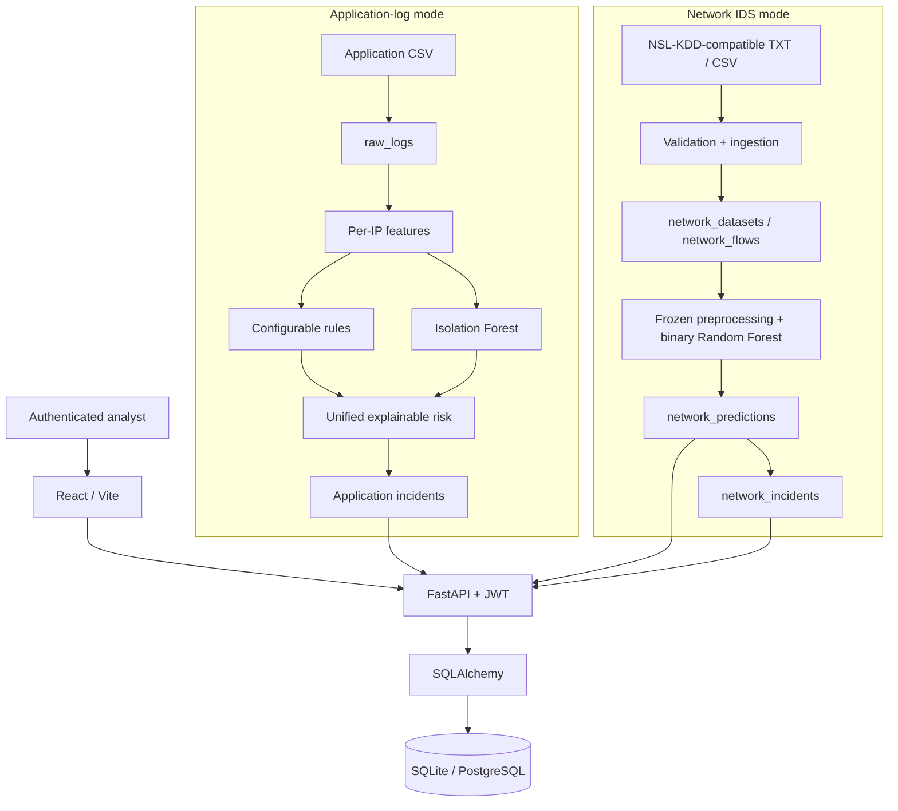
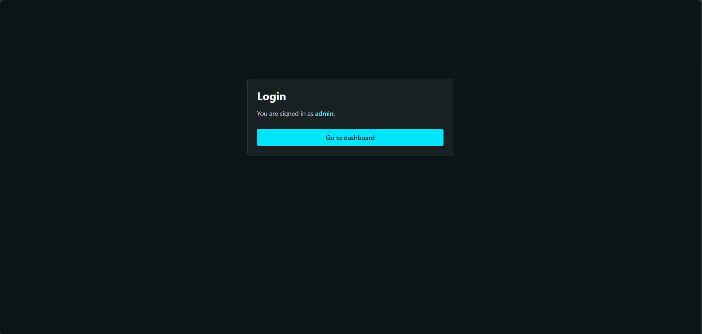
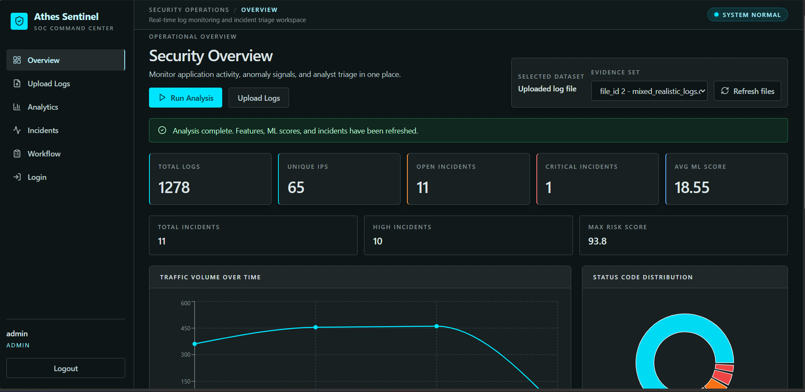
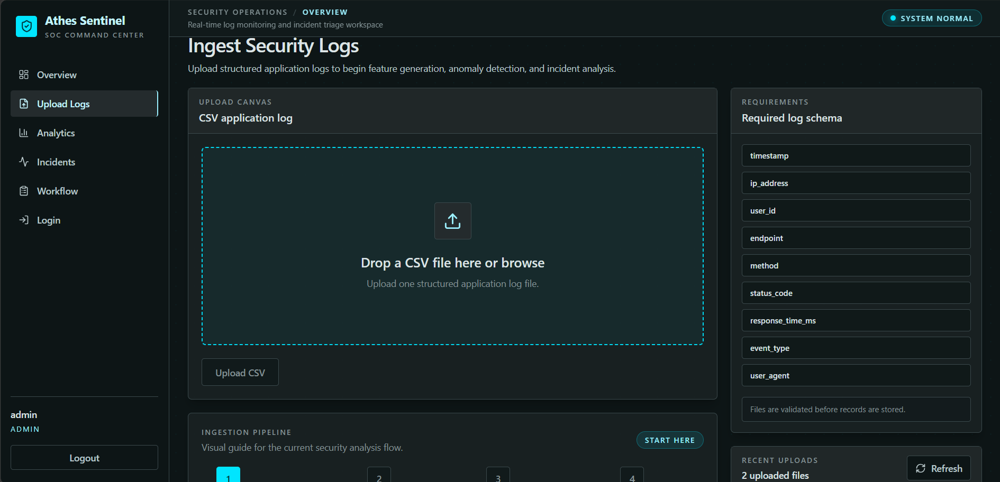
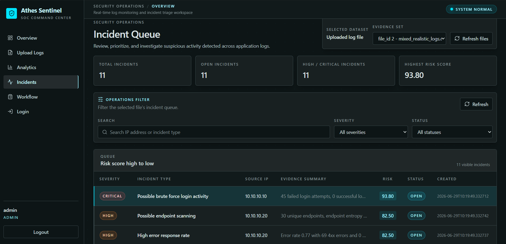
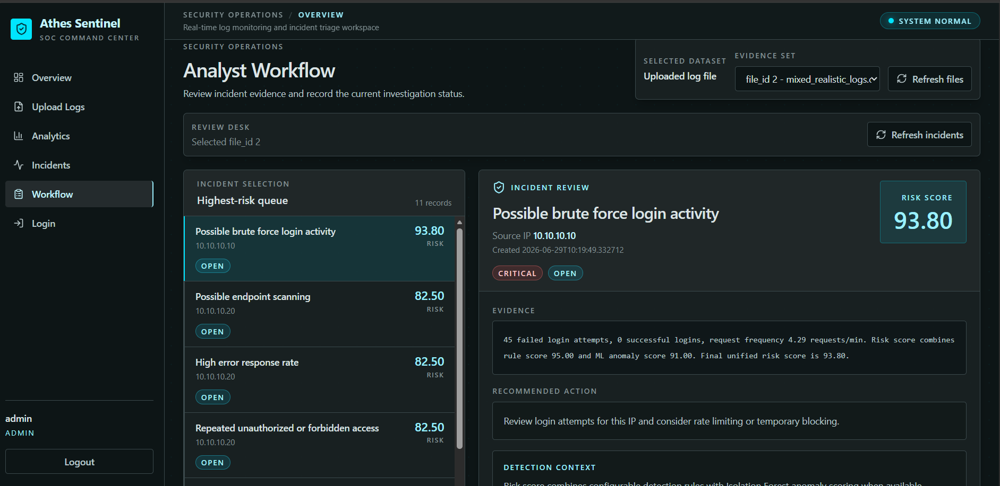

# Athes Sentinel

Athes Sentinel is a full-stack security monitoring and incident-triage platform with authenticated ingestion, persisted analytics, explainable incidents, and analyst workflow. It contains two distinct analysis modes:

1. application-log monitoring with rules and Isolation Forest anomaly scoring;
2. NSL-KDD-compatible network-intrusion detection with a reproducibly trained, frozen binary Random Forest.

This is a portfolio and learning project, not a production SIEM replacement, packet sensor, or automated blocking system.

> **Release status:** the deployed `master` application remains the stable application-log version. The complete Network IDS mode is on the verified `nsl-kdd-integration` feature branch pending review; this documentation does not imply that it has been deployed.

## Live application-log demo

- Application: [https://athes-sentinel.vercel.app](https://athes-sentinel.vercel.app/)
- API health: [https://athes-sentinel-api.onrender.com](https://athes-sentinel-api.onrender.com/)
- Repository: [https://github.com/nandini-neelesh/athes-sentinel](https://github.com/nandini-neelesh/athes-sentinel)

The hosted portfolio demo uses public demo credentials and a free-tier backend that may need time to wake after inactivity.

## Project highlights

- React/Vite interface with separate application-log and Network IDS navigation.
- Authenticated FastAPI backend with JWT-protected routes.
- SQLAlchemy persistence using SQLite locally and PostgreSQL on Render.
- Reproducible NSL-KDD inspection, training, selection, and verification scripts.
- Tracked, hash-verified preprocessing-plus-model artifact.
- Explainable analyst incidents using real stored context.
- Persisted dashboard analytics, backend filtering, search, and pagination.
- Idempotent completed network analysis and rollback-safe child writes.
- Disposable-database E2E and clean-checkout deployment-readiness verification.

## Two analysis modes

### 1. Application-log monitoring

The original mode accepts structured application-request CSV data and:

- stores raw application logs;
- engineers per-IP request, status, endpoint, timing, and frequency features;
- applies configurable rules for patterns such as brute force, scanning, unauthorized access, error spikes, and slow responses;
- runs Isolation Forest over numeric per-IP feature rows;
- combines readable rule evidence and the anomaly signal into an explainable risk score;
- generates incidents with recommended actions and persistent analyst status.

### 2. Network intrusion detection

The network mode accepts official-schema NSL-KDD-compatible `.txt` and `.csv` connection records and:

- stores all 41 original features in source order;
- supports optional benchmark `label` and `difficulty_level` columns;
- runs a frozen preprocessing-plus-`RandomForestClassifier` pipeline;
- persists 0–1 attack probabilities and binary `normal`/`attack` predictions;
- creates one explainable incident per predicted attack;
- provides dataset overview, analytics, incident queue/detail, and workflow pages.

The two modes do not share a model pipeline. The application-log mode uses Isolation Forest anomaly scoring; the final network detector is a supervised binary Random Forest. The network model does not predict DoS, Probe, R2L, or U2R families—those values are supplied benchmark ground truth used only for evaluation.

## Architecture



See [Architecture](docs/ARCHITECTURE.md) for component boundaries, persistence design, execution behavior, and deployment topology.

## Why NSL-KDD

NSL-KDD was selected as a structured, labelled benchmark that supports a complete and reproducible supervised-learning exercise: fixed complete train/test files, mixed categorical and numeric features, attack labels unseen during training, and enough rows to exercise full-stack ingestion and batched inference.

It is also an older benchmark. Its data distribution is not representative of current production networks, so these results should not be treated as proof of modern operational detection quality.

## Supported network files

| Format | Supported structure |
| --- | --- |
| Headerless `.txt` or `.csv` | exactly 41 official feature columns |
| Headerless official labelled file | exactly 43 columns: 41 features, `label`, `difficulty_level` |
| Headered CSV | exact 41 feature names in any order |
| Headered labelled CSV | exact 43 official names in any order |

- Maximum application upload size: 50 MiB.
- A 42-column partial structure is rejected.
- Arbitrary firewall logs, packet captures, PCAP files, and unrelated CSV schemas are unsupported.
- Uploaded bytes are parsed and not retained as physical files.
- Analysis starts only when an authenticated user explicitly requests it.

Raw NSL-KDD files are intentionally ignored and are not distributed in this repository. Obtain them independently and place complete files at:

```text
data/external/nsl-kdd/KDDTrain+.txt
data/external/nsl-kdd/KDDTest+.txt
```

The committed model used every row of complete `KDDTrain+.txt` for final fitting and complete `KDDTest+.txt` for final benchmark evaluation. Sampled, 20-percent, `KDDTest-21`, ARFF, and synthetic data were not used.

## Network model development

### N2 baseline

The fixed baseline fitted preprocessing and a 200-tree Random Forest on all 125,973 training rows, then evaluated all 22,544 test rows at threshold 0.50.

| Metric | Baseline |
| --- | ---: |
| Recall | 0.600717 |
| F1 | 0.741001 |
| F2 | 0.649934 |
| False-positive rate | 0.027289 |

### N2.1 final selected detector

Three fixed supervised pipelines were compared using one stratified 80/20 split of the complete training file. Candidate thresholds from 0.10 through 0.90 were selected on validation data using an F2-oriented policy with a preferred false-positive-rate ceiling of 0.05.

Candidate B—the recall-oriented Random Forest—was selected:

| Parameter | Final value |
| --- | --- |
| Trees | 300 |
| Maximum depth | none |
| Minimum leaf size | 1 |
| Class weights | `{0: 1.0, 1: 2.0}` |
| Random state | 42 |
| Parallel jobs | `-1` |
| Attack threshold | 0.38 |

The selected fresh pipeline was fitted on all 125,973 training rows before official-test evaluation.

Phase N2 had already inspected the official test set for its baseline. The narrower, accurate claim is that N2.1 candidate and threshold selection used only its new training/validation split, and no N2.1 test metric was used to revise either choice.

### N2.2 controlled hybrid experiment

A Random Forest plus Isolation Forest fusion was selected on training-only data and judged once on an untouched internal holdout. Compared with Random Forest alone, it detected two additional attacks but produced 18 additional false positives and reduced holdout F2 from `0.999068` to `0.998841`.

The hybrid was therefore rejected under the declared gate, and N2.1 remained the final detector. This is evidence-based model selection rather than a claim that hybrid anomaly detection always helps.

Full methodology is documented in [Network IDS](docs/NETWORK_IDS.md).

## Final official-test benchmark

| Metric | Result |
| --- | ---: |
| Test records | 22,544 |
| Accuracy | 0.811968 |
| Precision | 0.968185 |
| Recall | 0.692434 |
| F1 | 0.807414 |
| F2 | 0.734259 |
| False-positive rate | 0.030069 |
| False-negative rate | 0.307566 |
| TN | 9,419 |
| FP | 292 |
| FN | 3,947 |
| TP | 8,886 |

Detection recall by supplied benchmark family:

| Supplied benchmark family | Recall |
| --- | ---: |
| DoS | 0.857105 |
| Probe | 0.888063 |
| R2L | 0.112652 |
| U2R | 0.253731 |

These are evaluation breakdowns from actual labels; the model remains binary. Weak R2L and U2R recall is an explicit limitation.

The tracked final artifact is:

```text
ml_pipeline/artifacts/nsl_kdd_improved_binary_pipeline.joblib
```

- Size: 6,705,637 bytes.
- SHA-256: `09b4cac3372256c3122bcfb5555706d63397e8449385470a283427e688691c13`.
- Serialization version: scikit-learn 1.9.0.
- Contents: fitted preprocessing and fitted Random Forest.

## Explainable network incidents

Every predicted attack creates an analyst incident containing:

- model probability;
- `risk_score = probability × 100`;
- probability-derived severity;
- real protocol, service, flag, byte, login, count, and selected error-rate context;
- evidence phrased as suspicion rather than certainty;
- restrained recommended analyst action;
- persistent status: `open`, `investigating`, `resolved`, or `false_positive`.

| Probability | Triage severity |
| --- | --- |
| `>= 0.90` | critical |
| `>= 0.75` and `< 0.90` | high |
| `>= 0.60` and `< 0.75` | medium |
| `>= 0.38` and `< 0.60` | low |

Severity is an analyst-facing product triage level, not an attack-family prediction. Status updates do not retrain the frozen model, and Athes Sentinel does not automatically block traffic.

## Technology stack

### Frontend

- React 18 and Vite
- Tailwind CSS
- Recharts
- Axios
- React Router
- Lucide icons

### Backend and model

- FastAPI and Uvicorn
- SQLAlchemy and Pydantic
- Pandas and NumPy
- scikit-learn 1.9.0
- joblib
- `python-multipart`
- `python-jose[cryptography]`
- `passlib[bcrypt]` and bcrypt 4.0.1

### Storage and deployment

- SQLite for local development
- PostgreSQL and backend hosting on Render
- React frontend hosting on Vercel

## Repository structure

```text
athes-sentinel/
├── backend/app/
│   ├── analytics/                 # Application-log analytics
│   ├── auth/                      # JWT authentication
│   ├── database/
│   │   ├── models.py              # Existing application models
│   │   └── network_models.py      # Additive Network IDS tables
│   ├── detection/                 # Application rules and Isolation Forest
│   ├── logs/ and features/        # Application-log ingestion/features
│   ├── ml/
│   │   └── nsl_kdd_inference.py   # Frozen network-model inference
│   ├── network/                   # Network ingestion, analysis, reads/workflow
│   └── main.py
├── frontend/src/
│   ├── api/                       # Authenticated API wrappers
│   ├── context/                   # Auth, file, and network dataset selection
│   └── pages/network/             # Network upload/overview/analytics/workflow
├── ml_pipeline/                   # Inspection, training, reports, metadata/artifact
├── scripts/
│   ├── verify_network_e2e.py
│   └── verify_deployment_readiness.py
├── docs/
│   ├── ARCHITECTURE.md
│   ├── NETWORK_IDS.md
│   ├── DEPLOYMENT.md
│   └── screenshots/
├── render.yaml
└── requirements.txt
```

## Local setup on Windows PowerShell

### 1. Python environment

From the repository root:

```powershell
python -m venv venv
.\venv\Scripts\python.exe -m pip install --upgrade pip
.\venv\Scripts\python.exe -m pip install -r requirements.txt
```

Backend environment variables are process variables. The root `.env.example` is a safe reference; the application does not automatically load it. Local development can use the checked defaults:

- SQLite at `./athes_sentinel.db`;
- development-only JWT fallback;
- CORS origin `http://localhost:5173`.

To set explicit local values:

```powershell
$env:ATHES_ENV="development"
$env:DATABASE_URL="sqlite:///./athes_sentinel.db"
$env:ATHES_SECRET_KEY="replace-with-a-local-development-secret"
$env:ATHES_ALLOWED_ORIGINS="http://localhost:5173"
```

Run the backend:

```powershell
.\venv\Scripts\python.exe -m uvicorn backend.app.main:app --host 127.0.0.1 --port 8000 --reload
```

- API: `http://127.0.0.1:8000`
- Interactive docs: `http://127.0.0.1:8000/docs`

### 2. Frontend

```powershell
cd frontend
npm.cmd install
npm.cmd run dev
```

Vite development defaults to `http://127.0.0.1:8000`. To configure it explicitly:

```powershell
$env:VITE_API_BASE_URL="http://127.0.0.1:8000"
npm.cmd run dev
```

The frontend development URL is `http://localhost:5173`.

### 3. Dataset placement

For network model/E2E verification, place complete ignored files at:

```text
data/external/nsl-kdd/KDDTrain+.txt
data/external/nsl-kdd/KDDTest+.txt
```

For the original application-log demo, use:

```text
data/mixed_realistic_logs.csv
```

### 4. Demo credentials

These are intentional public development/demo credentials. Do not use them for a real production deployment.

| Role | Username | Password |
| --- | --- | --- |
| Admin | `admin` | `admin123` |
| Analyst | `analyst` | `analyst123` |

## API summary

### Application-log API groups

| Group | Representative endpoints | Purpose |
| --- | --- | --- |
| Auth | `POST /auth/login`, `GET /auth/me` | Login and current user |
| Logs | `POST /logs/upload`, `GET /logs/files`, `GET /logs` | Upload and read application logs |
| Features | `POST /features/generate/{file_id}`, `GET /features/{file_id}` | Generate/read per-IP features |
| ML | `POST /ml/run/{file_id}`, `GET /ml/scores/{file_id}` | Run/read application Isolation Forest scores |
| Incidents | `POST /incidents/generate/{file_id}`, `GET /incidents`, `PATCH /incidents/{incident_id}/status` | Generate and triage application incidents |
| Analytics | `/analytics/summary/{file_id}` and related routes | Application dashboard aggregations |

### Network IDS API

Every endpoint requires bearer JWT authentication.

| Method | Endpoint | Purpose | Auth |
| --- | --- | --- | --- |
| POST | `/network/datasets/upload` | Validate and persist one dataset | JWT |
| GET | `/network/datasets` | List datasets | JWT |
| GET | `/network/datasets/{dataset_id}` | Read dataset metadata/counts | JWT |
| GET | `/network/datasets/{dataset_id}/flows` | Read source-ordered original flows | JWT |
| POST | `/network/datasets/{dataset_id}/analyze` | Run/reuse frozen analysis | JWT |
| GET | `/network/datasets/{dataset_id}/analysis` | Read persisted analysis summary | JWT |
| GET | `/network/datasets/{dataset_id}/dashboard` | Read KPIs and priority incidents | JWT |
| GET | `/network/datasets/{dataset_id}/analytics` | Read persisted distributions | JWT |
| GET | `/network/datasets/{dataset_id}/incidents` | Filter/paginate incident queue | JWT |
| GET | `/network/incidents/{incident_id}` | Read complete incident detail | JWT |
| PATCH | `/network/incidents/{incident_id}/status` | Persist analyst workflow status | JWT |

## Verification commands

From the repository root:

```powershell
.\venv\Scripts\python.exe -m unittest discover -s backend/app/tests -p "test*.py" -v
.\venv\Scripts\python.exe -m ml_pipeline.verify_final_model
.\venv\Scripts\python.exe scripts\verify_network_e2e.py
.\venv\Scripts\python.exe scripts\verify_deployment_readiness.py
```

Production frontend build:

```powershell
cd frontend
$env:VITE_API_BASE_URL="https://api-verification.example.invalid"
npm.cmd run build
Remove-Item -LiteralPath dist -Recurse -Force
```

The final-model and network E2E verifiers require complete ignored `KDDTest+.txt`. The E2E verifier uses disposable SQLite, uploads all 22,544 rows through real HTTP routes, runs the actual frozen artifact, validates persisted dashboard/analytics/incidents/workflow behavior, and leaves the normal local/deployed databases untouched.

The deployment-readiness verifier does not depend on raw datasets. It audits committed artifact availability, clean-checkout loading, runtime declarations, production-style startup, PostgreSQL DDL compilation, CORS/environment behavior, frontend build configuration, and repository hygiene without contacting live services.

## Screenshots

The existing screenshots show the deployed application-log mode:

### Login



### Security Overview



### Ingest Security Logs



### Incident Queue



### Analyst Workflow



Network Overview, Upload Dataset, Network Analytics, Network Incident Queue, and Network Analyst Workflow screenshots have not been checked into the repository. They should be captured after local or reviewed live visual verification; no placeholder images are presented as completed screens.

## Production configuration

Backend:

- `DATABASE_URL`
- `ATHES_SECRET_KEY`
- `ATHES_ENV=production`
- `ATHES_ALLOWED_ORIGINS=https://your-project.vercel.app`

Frontend:

- `VITE_API_BASE_URL=https://your-render-service.onrender.com`

Production backend startup fails clearly when its JWT secret or allowed origin is absent. The production frontend requires `VITE_API_BASE_URL` and raises a clear initialization error if it is absent. Localhost fallbacks apply only to development.

Use exact HTTPS frontend origins for credentialed CORS; do not use wildcard `*`. See [Deployment Review Guide](docs/DEPLOYMENT.md) for the planned release order, smoke test, database behavior, and hosting limitations.

## Known limitations

- NSL-KDD is old and subject to distribution shift.
- R2L and U2R recall remains weak.
- Network prediction is binary rather than multiclass/family classification.
- NSL-KDD records do not contain source/destination IP addresses.
- Network mode does not ingest PCAP or arbitrary firewall/log formats.
- Upload parsing and network analysis are synchronous.
- There is no background worker or object storage.
- There is no automatic blocking or remediation.
- Startup uses `create_all()` rather than Alembic migrations.
- Hosted request size, memory, and timeout behavior still requires live-plan validation.
- Benchmark performance is not proof of modern production effectiveness.
- Demo authentication is intentionally simple and unsuitable for a real security product.

## Recruiter/interview summary

Athes Sentinel is a deployed full-stack security monitoring platform with authenticated ingestion, application-log anomaly analysis, a reproducibly trained binary network-intrusion classifier, persisted explainable incidents, backend-driven analytics, and analyst workflow. Its network release is benchmarked and deployment-audited, while its limitations and rejected hybrid experiment are documented explicitly.
