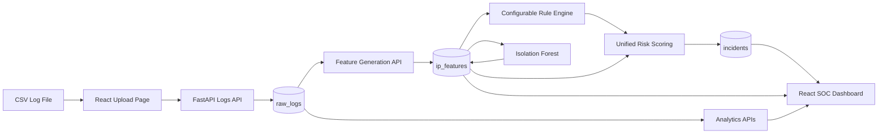

# Athes Sentinel

Athes Sentinel is a lightweight SIEM-style application log monitoring platform built to demonstrate practical backend, security analytics, machine learning, and React dashboard engineering.

## Why This Project?

Modern applications produce large volumes of logs, but raw log lines are hard to review manually. Athes Sentinel turns structured application logs into a usable security workflow:

1. Upload application log CSV files.
2. Validate and store raw events.
3. Generate per-IP behavioral features.
4. Detect suspicious behavior with configurable rules and Isolation Forest.
5. Create explainable incidents with recommended actions.
6. Review, prioritize, and update analyst workflow status from a React SOC dashboard.

The project is intentionally lightweight and local-first. It is not a replacement for a production SIEM, but it shows the core ideas behind log ingestion, feature engineering, anomaly detection, incident scoring, and analyst triage.

## Key Features

- CSV upload with required schema validation.
- Raw application log storage in SQLite.
- Per-IP feature generation for:
  - request volume
  - 4xx and 5xx errors
  - endpoint entropy
  - sensitive endpoint activity
  - response-time behavior
  - request frequency
- Configurable rule detections for:
  - brute force login behavior
  - endpoint scanning
  - unauthorized access attempts
  - error spikes
  - slow response behavior
- Isolation Forest anomaly detection on per-IP feature rows.
- Unified incident risk score combining rule and ML signals.
- Explainable incident evidence and recommended action text.
- Incident workflow statuses: `open`, `investigating`, `resolved`, `false_positive`.
- JWT login with local demo users.
- Protected React routes for authenticated dashboard access.
- React pages for:
  - Security Overview
  - Ingest Security Logs
  - Log Analytics
  - Incident Queue
  - Analyst Workflow
- Real Run Analysis action:
  - feature generation
  - ML scoring
  - incident generation

## Architecture



### Main Components

| Layer | Technology | Purpose |
| --- | --- | --- |
| Backend API | FastAPI | Upload logs, generate features, run detection, serve incidents and analytics |
| Database | SQLite + SQLAlchemy | Store users, uploaded files, raw logs, IP features, and incidents |
| Data Processing | Pandas | Validate CSV data and compute feature tables |
| ML Detection | scikit-learn Isolation Forest | Score per-IP behavioral anomalies |
| Frontend | React + Vite + Tailwind CSS | Authenticated SOC dashboard and analyst workflow |
| Visualization | Recharts | Traffic, status-code, and endpoint analytics |
| HTTP Client | Axios | Frontend API integration |
| Auth | JWT | Demo login and protected routes |

## Detection and Risk Scoring

Athes Sentinel combines two detection approaches:

### Configurable Rules

The rule engine uses readable thresholds over per-IP features. It checks for patterns such as repeated login failures, many unique endpoints, repeated 403/404 behavior, high error rates, and slow response times. Rule findings include a rule score, severity, evidence, and recommended action.

### Isolation Forest

Isolation Forest runs on numeric per-IP feature rows, not raw log lines. It looks for IP behavior that differs from the rest of the uploaded file's traffic. The resulting `ml_anomaly_score` is stored with the IP feature row.

### Unified Risk Score

When ML scores are available, incident risk uses:

```text
unified risk score = 70% rule score + 30% ML anomaly score
```

If ML has not been run, incidents can still be generated from rule findings, and the rule score is used by itself. This keeps the system useful even before ML scoring is available.

## Screens and User Workflow

The React dashboard follows this real user path:

```text
Login
-> Upload Logs
-> Run Analysis
-> Review Dashboard
-> Explore Analytics
-> Triage Incidents
-> Update Workflow Status
```

Main screens:

| Screen | Purpose |
| --- | --- |
| Login | Sign in with a local demo user |
| Security Overview | View key metrics, traffic chart, status-code distribution, priority incidents, and pipeline state |
| Ingest Security Logs | Upload a structured CSV log file |
| Log Analytics | Explore traffic volume, source IPs, endpoints, response times, and error rates |
| Incident Queue | Review generated incidents sorted by risk score |
| Analyst Workflow | Select an incident and update investigation status |

## Required CSV Schema

Uploaded CSV files must include these columns:

| Column | Description |
| --- | --- |
| `timestamp` | Event timestamp parseable as a datetime |
| `ip_address` | Source IP address for the request |
| `user_id` | User identifier if available |
| `endpoint` | Requested application endpoint |
| `method` | HTTP method such as `GET`, `POST`, `PUT`, or `DELETE` |
| `status_code` | HTTP response status code |
| `response_time_ms` | Response time in milliseconds |
| `event_type` | Event label such as `page_view`, `login_failed`, or `api_request` |
| `user_agent` | User agent string or client identifier |

## Local Setup on Windows

These commands assume the repository is located at:

```powershell
D:\Athes Sentinel\athes-sentinel
```

### Backend Setup

```powershell
cd "D:\Athes Sentinel\athes-sentinel"
.\venv\Scripts\python.exe -m pip install -r requirements.txt
```

Run the FastAPI backend:

```powershell
cd "D:\Athes Sentinel\athes-sentinel"
.\venv\Scripts\python.exe -m uvicorn backend.app.main:app --host 127.0.0.1 --port 8000 --reload
```

Backend URL:

```text
http://127.0.0.1:8000
```

FastAPI docs:

```text
http://127.0.0.1:8000/docs
```

### Frontend Setup

```powershell
cd "D:\Athes Sentinel\athes-sentinel\frontend"
npm install
npm run dev
```

Frontend URL:

```text
http://localhost:5173
```

The frontend defaults to:

```text
http://127.0.0.1:8000
```

You can override the backend URL with `VITE_API_BASE_URL`:

```powershell
cd "D:\Athes Sentinel\athes-sentinel\frontend"
$env:VITE_API_BASE_URL="http://127.0.0.1:8000"
npm run dev
```

## Demo Login Credentials

These accounts are for local demo use only. Do not use these credentials in production.

| Role | Username | Password |
| --- | --- | --- |
| Admin | `admin` | `admin123` |
| Analyst | `analyst` | `analyst123` |

## API Overview

| Group | Example Endpoints | Purpose |
| --- | --- | --- |
| Auth | `POST /auth/login`, `GET /auth/me` | JWT login and current-user lookup |
| Logs | `POST /logs/upload`, `GET /logs/files`, `GET /logs` | Upload CSV files and retrieve stored logs |
| Features | `POST /features/generate/{file_id}`, `GET /features/{file_id}` | Generate and view per-IP feature rows |
| ML | `POST /ml/run/{file_id}`, `GET /ml/scores/{file_id}` | Run Isolation Forest and view anomaly scores |
| Incidents | `POST /incidents/generate/{file_id}`, `GET /incidents`, `PATCH /incidents/{incident_id}/status` | Generate, list, inspect, and update incidents |
| Analytics | `/analytics/summary/{file_id}`, `/analytics/hourly-traffic/{file_id}`, `/analytics/top-ips/{file_id}` | Dashboard and chart data |

## Demo Dataset

The main local demo dataset is:

```text
data/mixed_realistic_logs.csv
```

It contains mostly normal web/application traffic plus simulated suspicious behavior patterns:

- brute force login attempts
- endpoint scanning
- unauthorized access attempts
- server error spikes
- slow response behavior

Suggested demo flow:

1. Start the backend.
2. Start the React frontend.
3. Log in with a demo account.
4. Upload `data/mixed_realistic_logs.csv`.
5. Open Security Overview.
6. Click Run Analysis.
7. Review incidents and analytics.
8. Update an incident status in Analyst Workflow.

## Limitations and Future Improvements

- SQLite is suitable for local/demo use; a production deployment should use persistent PostgreSQL.
- No real-time streaming ingestion yet.
- No automatic blocking or remediation actions.
- Demo authentication only; production would need secrets management, stronger user management, rate limiting, audit logs, and HTTPS.
- Detection thresholds are configurable but still intentionally simple for readability.
- Isolation Forest scores are useful for demonstration, but production anomaly detection would require stronger validation, monitoring, and model governance.

## Project Structure

```text
athes-sentinel/
|-- backend/
|   `-- app/
|       |-- analytics/      # Dashboard analytics service and routes
|       |-- auth/           # JWT schemas, services, and routes
|       |-- database/       # SQLAlchemy session and ORM models
|       |-- detection/      # Rule engine, ML model, risk scoring, routes
|       |-- features/       # Per-IP feature engineering and routes
|       |-- incidents/      # Incident generation, formatting, and routes
|       |-- logs/           # CSV validation, upload service, and routes
|       `-- main.py         # FastAPI application entry point
|-- data/
|   |-- generate_demo_dataset.py
|   `-- mixed_realistic_logs.csv
|-- frontend/
|   |-- src/
|   |   |-- api/            # Axios API wrappers
|   |   |-- components/     # Shared React components
|   |   |-- context/        # Auth and selected-file context
|   |   `-- pages/          # Dashboard, upload, analytics, incidents, workflow, login
|   |-- package.json
|   `-- vite.config.js
|-- requirements.txt
|-- athes_sentinel.db       # Local SQLite database
`-- README.md
```

## Built for Learning and Portfolio Demonstration

Athes Sentinel is built to show end-to-end security product thinking: ingestion, validation, feature engineering, rule-based detection, ML anomaly scoring, explainable incident generation, and analyst workflow in one coherent local application.
