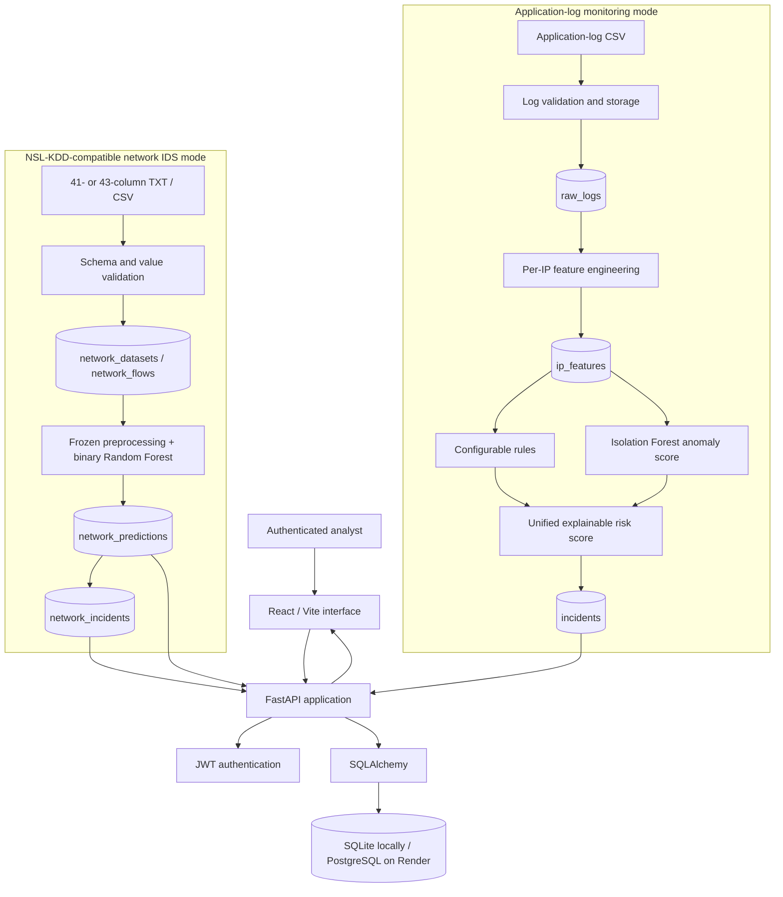
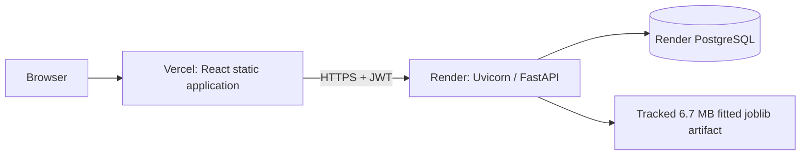

# Athes Sentinel Architecture

Athes Sentinel is one authenticated React and FastAPI application with two separate security-analysis modes. They share authentication, persistence, API infrastructure, analyst workflow concepts, and deployment providers, but their data models and machine-learning pipelines are intentionally distinct.

## System overview



## Application-log pipeline

The original mode ingests structured application-request logs. It stores raw events, derives one behavioral feature row per IP, applies readable detection rules, and optionally calculates an Isolation Forest anomaly signal. Rule and anomaly evidence contribute to an explainable incident risk score.

This Isolation Forest is part of the application-log pipeline. It is not the deployed network intrusion classifier.

## Network IDS pipeline

```text
NSL-KDD-compatible TXT/CSV
→ FastAPI validation and ingestion
→ network_datasets/network_flows
→ verified frozen preprocessing + Random Forest
→ probability and binary prediction
→ network_predictions
→ explainable network_incidents
→ dashboard/analytics/queue/workflow APIs
→ React Network IDS interface
```

The network model consumes 40 trained inputs from the 41 official features:

- three categorical inputs: `protocol_type`, `service`, and `flag`;
- 37 numeric inputs;
- `num_outbound_cmds` is retained in the original stored flow but excluded from inference because it is constant in the complete benchmark files;
- `label` and `difficulty_level`, when supplied, are benchmark context and never model features.

The fitted scikit-learn `Pipeline` owns one-hot encoding and classification. Application inference does not manually encode or fit data.

## Persistence model

Nine SQLAlchemy tables are registered:

| Mode | Tables |
| --- | --- |
| Shared/authentication | `users` |
| Application logs | `log_files`, `raw_logs`, `ip_features`, `incidents` |
| Network IDS | `network_datasets`, `network_flows`, `network_predictions`, `network_incidents` |

Deleting a network dataset cascades through its flows, predictions, and incidents. Each flow has at most one final prediction, and each predicted-attack record has at most one network incident.

Network rows retain the original 41 fields. The database does not store the 121 transformed one-hot features, and it does not invent IP addresses, endpoints, or users that NSL-KDD does not provide.

## Backend boundaries

- `backend/app/auth/`: JWT login and authenticated-user dependency. Every router
  except the health check and `POST /auth/login` attaches `get_current_user`, so
  30 of the 32 API operations require a bearer token. `require_role` is defined
  here but is currently unused: the system performs authentication, not
  role-based authorisation.
- `backend/app/database/`: shared SQLAlchemy base/session plus application and network models.
- `backend/app/logs/`, `features/`, `detection/`, `incidents/`, `analytics/`: application-log mode.
- `backend/app/network/`: upload, persisted analysis, analytics, incident, and workflow services/routes.
- `backend/app/ml/nsl_kdd_inference.py`: lazy, hash-verified loading and validated prediction through the frozen model.
- `backend/app/main.py`: application construction, router registration, CORS, and startup `create_all()`.

Network analysis is synchronous and processes stored flows in batches of 5,000. Model loading uses an `lru_cache(maxsize=1)`, so each application process loads the verified artifact once on first inference rather than at startup.

## Frontend boundaries

The application-log and network pages coexist under separate routes and selection contexts:

- application routes: `/`, `/upload`, `/analytics`, `/incidents`, `/workflow`;
- network routes: `/network`, `/network/upload`, `/network/analytics`, `/network/incidents`, `/network/workflow`;
- `FileContext` stores application-log file selection;
- `NetworkDatasetContext` independently stores network dataset selection.

All protected pages use the existing authentication context and Axios client.

## Deployment topology



No Redis, Celery, Kafka, object storage, worker queue, or WebSocket service is currently part of the architecture.

## Database initialization limitation

Startup imports all models and runs `Base.metadata.create_all()`. This creates missing tables in SQLite or PostgreSQL, but it is not a versioned migration system. Future changes to existing persistent schemas should use a formal migration tool such as Alembic rather than relying on `create_all()`.
